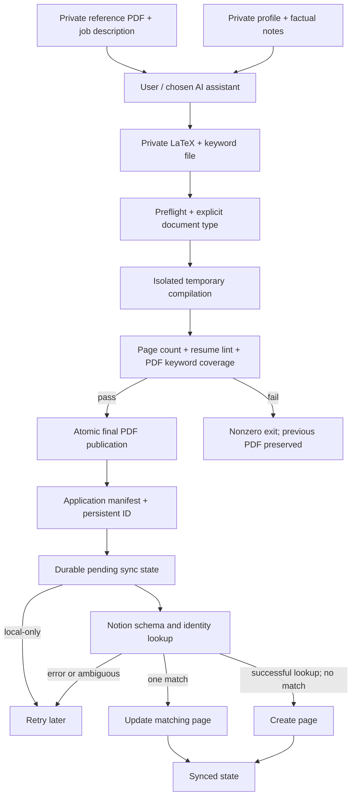

# Architecture and GitHub publication design

## Scope and deployment model

ResumeAgent is a local CLI plus an assistant workflow. It has no backend server,
account system, telemetry, hosted storage, LLM credentials or remote worker.
Each fork owner creates a Python virtual environment and connects their own Notion
workspace. Forking transfers the code; it does not transfer private documents or
credentials. Notion synchronization is the only application network boundary.
Dependency installation and optional vulnerability audits also access package services.

## Data flow

The assistant stage is outside the deterministic code pipeline. Documents are data;
instructions inside a job PDF must not override agent instructions. All claims need
human review against the private reference and verified background.

## Module boundaries

| Module | Responsibility | Side effects |
| --- | --- | --- |
| `build.sh` | Select the project interpreter | Executes the build CLI |
| `scripts/setup.sh` | Reproducible local bootstrap | Installs pinned packages; initializes local files |
| `scripts/init_local.py` | Safe first-run scaffolding | Creates ignored files with restrictive permissions; never overwrites |
| `scripts/profile_config.py` | Validate candidate configuration | Reads local profile or fictional defaults |
| `scripts/preflight.py` | Verify Python and system dependencies | None |
| `scripts/build_resume.py` | Orchestrate compile, checks, publication and sync | Local artifacts and one scoped sync process |
| `checks/lint_resume.py` | Check source structure and PDF layout | Reads source/PDF/profile |
| `checks/ats_check.py` | Measure required/preferred keywords in extracted PDF text | Runs `pdftotext` |
| `scripts/applications.py` | Identity, manifest parsing, locks and atomic writes | Private Markdown and JSON state |
| `scripts/check_notion.py` | Read-only connectivity/schema diagnosis | Notion read requests |
| `scripts/sync_applications_to_notion.py` | Resolve schema, match and upsert pages | Notion metadata and private sync state |
| `scripts/check_public_tree.py` | Audit staged public content | Reads Git index blobs; reports filenames only |
| `scripts/package_release.py` | Package verified committed source | Source archive/checksum in ignored `dist/` |

## Files to publish, and why

`public-files.txt` lists every approved path. It is reviewed with code changes;
a contributor cannot publish an unlisted file without failing CI. The scanner reads
Git's index rather than the working tree so a staged secret cannot be concealed by
editing its working copy afterward.

| Public category | Reason |
| --- | --- |
| Python/shell code under scripts and checks | Reusable deterministic workflow |
| Fictional source/JD/keywords under examples | Clean-clone demonstration and regression testing |
| Tests using temporary directories and mocks | Verify without exposing a real applicant or account |
| Example JSON and blank `.env.example` | Explain configuration without credentials |
| README, architecture, Notion guide, contribution/security docs | Reproducible setup and operation |
| Requirements, Makefile, lint configuration | Repeatable checks and dependency management |
| GitHub CI, tag-release workflow, Dependabot | Automated verification and source distribution |

Never publish `references/`, `inputs/`, `folder/outputs/`, `.state/`, `.env`,
`profile.local.json`, `applications.md`, `truth_ledger.md`, `bullet_bank.md`,
local assistant settings, interview preparation notes, PDFs, screenshots or office files.
A `.gitignore` prevents routine staging; it does not remove data already in history.
The initial repository contains only reviewed public files, so there is no private
history to clean. Later accidental disclosures require revocation and history cleanup.

## Candidate configuration

The distributed profile contains only a fictional name and reserved example-domain
email. Initialization copies it to `profile.local.json`. The user replaces the
header tokens and configures skill-line limits, page-fill threshold, unverified
adjacent terms and forbidden terms. No applicant-specific facts or truth rules are
hard-coded in published source. Real contact details belong only in the ignored profile.

The agent uses `references/current_resume.pdf` as the source of current facts/layout.
The public repository provides a technical LaTeX fixture, not a substitute candidate.
No real reference PDF or derivative is needed to run the test suite.

## Application identity and migration

Each row contains Date, Company, Role, Resume file, Cover letter, Status and Application ID.
New/legacy IDs are deterministic UUIDv5 values derived from normalized company, role and
date, then persisted. Once assigned, the ID remains stable across attachment changes.
Rows for separate roles/companies never collide merely because they share a resume.
For same-company/same-role applications on the same date, this schema represents one
application; distinct requisitions require a distinct role label. There is no requisition-ID field.

Rebuilds match an explicit ID or an unambiguous company/role/date selection. Invalid or
ambiguous input fails. Legacy six-column rows gain an ID without changing their other
fields. Existing Notion pages are matched by ID, then exact company + role + date for
migration. Multiple matches are an error, never an arbitrary first-page update.

## Failure and recovery contract

| Stage | Failure outcome | Recovery |
| --- | --- | --- |
| Inputs/dependencies | No compile or publication | Fix input or install dependencies |
| Compile/layout/ATS | No new final PDF; staged files removed | Fix source/keywords and rebuild |
| Local manifest write | Nonzero exit; validated PDF may already exist | Fix manifest and rebuild |
| Notion config/schema/lookup/write | Nonzero exit; PDF retained; pending/failed state | Fix connection/schema then `--live --pending` |
| Uncertain network create response | Retry checks persistent ID before create | Existing page updated if visible on retry |
| Duplicate remote identity | No upsert for that row | Resolve duplicate records manually |

Remote writes and local filesystem writes cannot form one transaction. Retry state is
best-effort durable JSON with atomic replacement and `fsync` of file content. A crash
between manifest write and state write may require an explicit `--application-id` sync
rather than `--pending`. There is no distributed exactly-once guarantee: Notion does
not enforce unique IDs, network visibility can lag, and two machines may race. Single-host
locks and identity lookups reduce this risk but are not a distributed lock service.

Notion is a one-way mirror of local metadata. Status and attachment filenames can be
overwritten from local values; manually edited Notion-only statuses are not merged.
The app does not upload resume PDFs, submit applications, or delete remote rows.

## CI and delivery boundaries

PR/main workflows use GitHub-hosted Ubuntu runners and a Python 3.10/3.12 matrix.
They verify the public inventory, install toolchains from scratch, initialize an empty
local workspace, lint/compile/test, build the fictional example and audit runtime pins.
The test suite uses mock Notion clients and no real credentials. No PDF artifacts or
private logs are uploaded. Workflows use read-only repository permissions except the
release-publishing job, which needs `contents: write` to create its release.

A `v*` tag calls the same verification workflow, then packages only `git archive HEAD`
and a SHA-256 checksum. Packaging checks that the scanned index matches HEAD. This
provides continuous delivery of local source software; it does not deploy private data
or run Notion synchronization in the cloud. Main branch protection should require both
matrix checks; see CONTRIBUTING.md for the check names and release steps.

Actions use immutable commit pins and untrusted PRs use `pull_request`, not
`pull_request_target`, following [GitHub's workflow security guidance](https://docs.github.com/en/actions/reference/security/secure-use).
Secrets are never required in CI. Dependabot proposes updates; checks must pass before merge.

## Extension points and constraints

A future LLM provider belongs behind an explicit local configuration boundary, with
opt-in data sharing and no keys in source. A future PDF-upload feature must document
that resume content leaves the machine. Alternate tracking backends should preserve
Application ID and failure semantics. Native Windows requires replacing POSIX locking
and shell entry points; WSL2 is the current supported route. macOS is locally exercised;
Linux is verified in hosted CI. Layout checks recognize the documented LaTeX conventions,
not every arbitrary CV template, and always need a visual review by the applicant.
